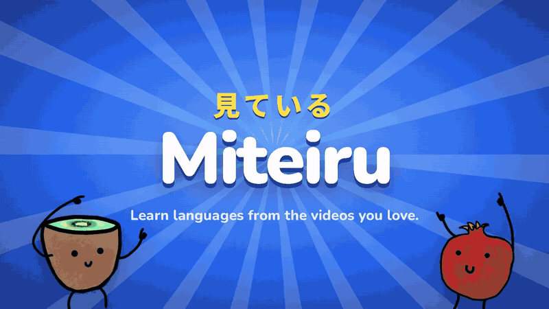
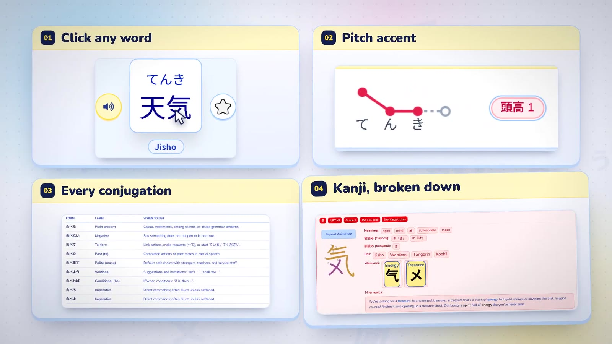
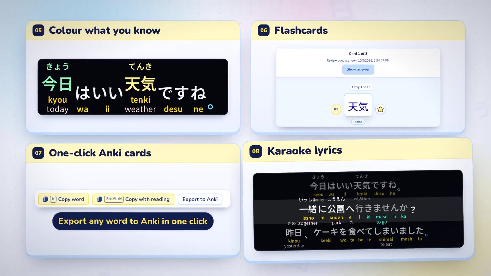
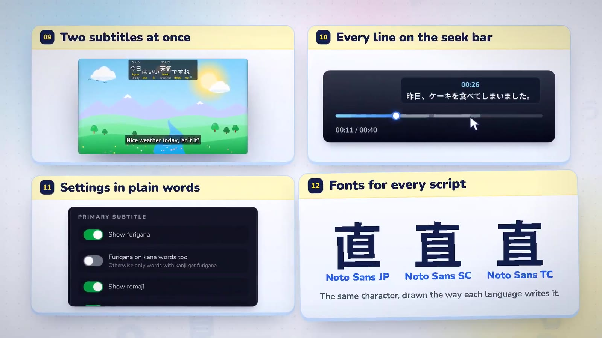
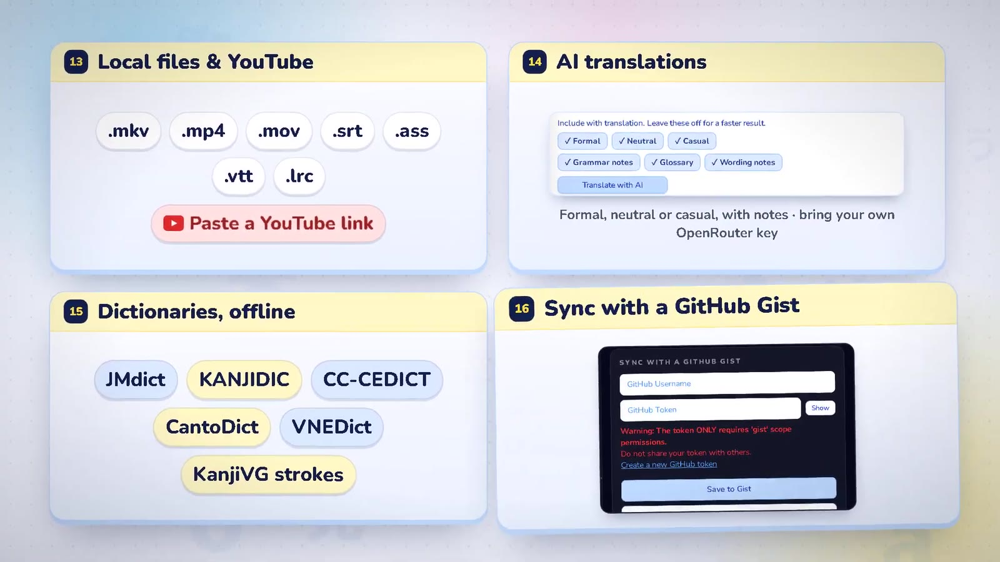
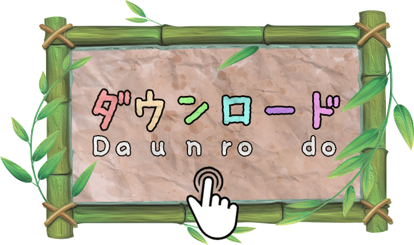

<div align="center">


# Miteiru 見ている

**Learn Japanese, Mandarin, Cantonese and Vietnamese from what you watch.**

A free video player that turns every subtitle word into something you can click,<br/>
with the reading on top, the meaning underneath and a full dictionary entry one click away.

[](https://github.com/hockyy/miteiru/releases/latest)
[](https://github.com/hockyy/miteiru/releases)
[](https://github.com/hockyy/miteiru/stargazers)
[](#download)
[](LICENSE.md)

**[⬇️ Download](https://github.com/hockyy/miteiru/releases/latest)** · **[🌐 Website](https://miteiru.hocky.id)** · **[▶️ Watch the 36-second trailer](https://youtu.be/-yslFBRBM2c)**



<sub>見ている · 在看 · 睇緊 · đang xem: "watching", in the four languages Miteiru speaks</sub>

</div>

## Why Miteiru?

- **Every word is clickable.** Subtitles are split into words (Kuromoji for Japanese, Jieba for Chinese) with furigana, pinyin or jyutping on top and short meanings underneath. Click a word for its full dictionary entry, pitch accent, conjugations and kanji breakdown.
- **Your videos, your subtitles.** Drop in local files (`.mkv`, `.mp4`, `.mov` and anything else Chromium plays) with `.srt`, `.ass`, `.vtt` or `.lrc` subtitles, or paste a YouTube link and pick one of its caption tracks.
- **Dictionaries ship with the app.** JMdict, KANJIDIC, CC-CEDICT, CantoDict and VNEDict work offline. No account, no subscription, no server.
- **Made for immersion.** Your target language on top and English underneath, a key to repeat the current line, karaoke lyrics, colours for the words you know, flashcards and one-click Anki cards.

## Features






<details>
<summary><b>Everything else</b></summary>

- `[` / `]` shift a subtitle's timing when it's out of sync.
- Lyrics search on [LRCLIB](https://lrclib.net) for music videos.
- Optional AI translations (formal, neutral or casual, with grammar notes), using your own OpenRouter key.
- Notes on words, a vocabulary sidebar, and syncing your progress through a GitHub Gist.
- Bundled subtitle fonts (Noto Sans JP, SC and TC), or any font installed on your computer.
- **CC Live** subtitles a video that has none, using the system's live captions (Windows, and recent macOS on Apple silicon).

</details>

## Download

<div align="center">
<a href="https://github.com/hockyy/miteiru/releases/latest"></a>
<a href="https://github.com/hockyy/miteiru/releases/latest"></a>
<a href="https://github.com/hockyy/miteiru/releases/latest"></a>
</div>

Get the newest version from **[Releases](https://github.com/hockyy/miteiru/releases/latest)**:

| Platform | File | Note |
| --- | --- | --- |
| Windows 10/11 | `miteiru-<version>-win-x64.exe` | The installer isn't code-signed, so SmartScreen may warn: **More info → Run anyway**. |
| macOS (Apple silicon) | `miteiru-<version>-mac-arm64.pkg` | Not notarized (no paid Apple Developer account): [open it anyway](https://support.apple.com/guide/mac-help/open-a-mac-app-from-an-unidentified-developer-mh40616/mac). |
| Linux | `.deb` or `.AppImage` | Built on Ubuntu 22.04 and 24.04. Pick yours; on other distributions, try the 22.04 AppImage. |

<details>
<summary>macOS: what the warning looks like</summary>


</details>

## Quick start

1. Open Miteiru and pick your language. Its dictionaries are already included.
2. Drag a video into the window (with its subtitle files, if you have them), or paste a YouTube link with **Ctrl+V**.
3. In the subtitle picker, your language goes on top and English underneath. Change either if you like.
4. Click any word. **R** repeats the line, **X** opens the settings, **Z** shows the controls and **Ctrl+H** goes home. Every shortcut is listed on the home screen.

> [!TIP]
> - **YouTube captions** come through [yt-dlp](https://github.com/yt-dlp/yt-dlp), and subtitles inside video files through FFmpeg. **Home → Settings & tools → Optional media tools** shows whether they're found and links to them.
> - **Anime subtitles:** many Japanese ones are on [kitsunekko](https://kitsunekko.net/).

## Languages

| | 🇯🇵 Japanese | 🇨🇳 Mandarin | 🇭🇰 Cantonese | 🇻🇳 Vietnamese |
| --- | --- | --- | --- | --- |
| Words split by | Kuromoji | Jieba | Jieba (Cantonese) | Longest match |
| Readings | Furigana, romaji | Pinyin | Jyutping | |
| Dictionary | JMdict, KANJIDIC | CC-CEDICT | CantoDict | VNEDict |
| Extras | Pitch accent, conjugations, kanji strokes | Simplified and traditional, hanzi strokes | Tone marks | A meaning under every word |

More detail in [README_LANGUAGES.md](README_LANGUAGES.md).

## FAQ

<details>
<summary><b>Is it really free?</b></summary>

Yes: no account, no ads, no subscription. Miteiru is licensed under [CC BY-NC-SA 4.0](LICENSE.md): you may share and adapt it for non-commercial use, with credit, under the same license.

</details>

<details>
<summary><b>Does it need the internet?</b></summary>

Only for YouTube and the optional AI translation. Local videos, subtitles and dictionary lookups work offline.

</details>

<details>
<summary><b>The YouTube subtitle list is empty</b></summary>

The subtitle picker says why. Usually yt-dlp is missing or outdated. Put a current `yt-dlp` in Miteiru's tools folder or on your PATH, then load the link again.

</details>

<details>
<summary><b>Found a bug or have an idea?</b></summary>

[Open an issue](https://github.com/hockyy/miteiru/issues/new/choose) or start a thread in [Discussions](https://github.com/hockyy/miteiru/discussions).

</details>

## Support Miteiru

If Miteiru helps you learn, **[give it a ⭐](https://github.com/hockyy/miteiru/stargazers)**: stars are how other learners find it. Telling your study group, class or Discord server about it helps even more.

## For developers

Needs **Node.js 22.12+**. `script:initrepo` downloads language assets from the [assets release](https://github.com/hockyy/miteiru/releases/tag/assets) into `renderer/public/language-assets`.

```bash
npm install
npm run script:initrepo
npm run dev
npm run build:nsis       # Windows installer (includes Live Captions helper)
npm run build:linux22    # Ubuntu 22.04
npm run build:linux24    # Ubuntu 24.04
npm run build:linux26    # Ubuntu 26.04
npm run build:macos      # macOS .pkg
```

Language assets:

```bash
npm run script:download-language-assets
npm run script:pack-language-assets
npm run script:unpack-language-assets
npm run script:download-language-assets -- mandarin han-character-core
```

`MITEIRU_FORCE_ASSET_DOWNLOAD=1` redownloads existing zips. More notes are in [`docs/`](docs), and contributions are welcome: see [CONTRIBUTING.md](CONTRIBUTING.md).

## Credits and license

Dictionary data comes from JMdict and KANJIDIC ([EDRDG](https://www.edrdg.org/)), CC-CEDICT, CantoDict, VNEDict and KanjiVG, each under its own license.

Miteiru is made by [Hocky Yudhiono](https://github.com/hockyy) and licensed under [CC BY-NC-SA 4.0](LICENSE.md). It is provided as is; use it at your own risk. Found a security issue? Email [miteiru@hocky.id](mailto:miteiru@hocky.id) or open an issue.
